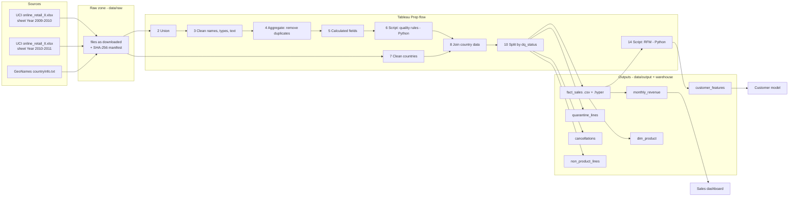

# Governance (Chapter 4)

Scenario: the shop's management uses our trusted data for a **sales dashboard** and a **customer model**
that predicts who will buy again (RFM segments).

## 1. Roles

| Role | In the shop | In our project | Duties | Example from this project |
|---|---|---|---|---|
| **Data Owner** (decides, accountable) | Head of Sales | group lead - TO CONFIRM | approves releases, decides who may use the data | approves version 1.0.0; decides that cancellations are a separate table, not deleted |
| **Data Steward** (cares for quality) | sales analyst | member - TO CONFIRM | keeps rules, dictionary and flow documentation correct | defines rules R1-R6 and the outlier rule; maintains the data dictionary |
| **Data Custodian** (runs the technology) | IT / data engineer | member - TO CONFIRM | runs the flow and TabPy, storage, backups, access | runs the Tableau Prep flow; keeps `data/raw` read-only; TabPy on localhost only |
| **Governance Manager** (sets policies) | data-protection officer | course rules + GDPR | company-wide rules | "raw data is never changed", "no data leaves the company without a licence check" |
| **Data Consumer** (uses, reports problems) | managers, data scientists | everyone using the outputs | use correctly, report problems | reports that 1,232 products had several names → steward builds `dim_product` |

The loop: consumer reports → steward fixes the rule and documents it → owner approves → custodian re-runs the flow.

## 2. Lineage: the metro map

- **Row-level lineage:** every row keeps `source_sheet` (which sheet) and `copies` (how many identical raw lines it stands for); with invoice, product and date it can be found again in the Excel file.
- **Upstream (root cause):** a strange revenue on the dashboard → `monthly_revenue` → `fact_sales` (filter month and country) → `source_sheet` + invoice → the raw line.
- **Downstream (impact):** if UCI renamed `Price`, the flow fails at step 3 (unknown field), so no dashboard is fed silently wrong data.

## 3. Provenance: the passport of one release

| Field | Value |
|---|---|
| Source | `online_retail_II.xlsx` (SHA-256 bcbe73b3...), `countryInfo.txt` (SHA-256 79f8f59e...) |
| Activity | Tableau Prep flow `prep/online_retail_flow.tfl` (steps 1-17) with Python Script steps |
| Agent | Data Custodian (TO CONFIRM), Tableau Prep Builder 2026.2, Python 3.12, TabPy 2.16 |
| Time | see `logs/pipeline_run_log.txt` |
| Result | `fact_sales` v1.0.0, fingerprints in `data/output/_manifest.json` |

## 4. Data classification and protection

| Data | Contains | Class | Controls |
|---|---|---|---|
| raw Excel file | customer IDs with countries and every purchase | **Confidential** | only in `data/raw`, never edited, not in Git |
| fact_sales, customer_features | customer IDs (pseudonymous numbers), purchase behaviour | **Confidential**: a customer ID plus behaviour can identify a small business or person, so it is still personal data under GDPR | aggregate use only; data contract; no names exist in the data |
| monthly_revenue, dim_product | totals per month/country, product names | **Internal** (business figures) | share inside the company |
| reports, charts | aggregates | **Public** after owner approval | - |

Measures used:
- **data minimisation:** the source has no names or addresses, and we add none;
- **access control:** the raw zone is git-ignored;
- **security:** TabPy runs on localhost only, because without a password it would run code for anyone on the network;
- **auditing:** run log, checksums, fingerprints.

## 5. Monitoring and observability

| Signal | How we watch it | What we saw |
|---|---|---|
| **Freshness** | latest invoice date vs. today | the data ends 2011-12-09; good for history, too old for a live model |
| **Volume** | raw rows per sheet in `_manifest.json` | 525,461 + 541,910 rows, reconciled exactly |
| **Schema** | the flow fails if a column is missing or renamed | stable 8 columns in both sheets |
| **Distribution** | profiling per month and sheet (`profile_lines_per_month.png`) | the two sheets **overlap in December 2010**: found only by looking at the distribution, no single rule fails |

## 6. AI risks

| Risk | Where in our data | Effect on a model | Our control |
|---|---|---|---|
| **Missing customers** | 22.6% of trusted lines have no customer ID (13.1% of revenue) | customer model ignores guest buyers; segments biased to registered (often wholesale) customers | flag `has_customer`; documented; revenue reports still include them |
| **Country bias** | United Kingdom = 85.5% of revenue | model learns UK behaviour; poor for small export countries | report per country; evaluate per country |
| **Outdated data (drift)** | 2009-2011, before COVID and today's online habits | patterns may no longer be true | stated limitation; re-train on new data |
| **Seasonality** | November peak (Christmas) | recency depends on the cut-off date | reference date documented (2011-12-10) |
| **Tie-breaking in RFM scores** | many customers have equal values (e.g. 1 invoice) | equal customers can get neighbouring scores | ties broken by customer_id: deterministic and documented |
| **Wrong labels from bad rows** | prices of 38,970 GBP, cancellations | money features distorted | quarantine + IQR flag; cancellations kept separately |
| **Re-identification** | customer ID + country + purchases | could identify a small business | aggregate use only (data contract), confidential class |
| **Regulation** | EU AI Act Art. 10: training data must be relevant, representative, as error-free and complete as possible, with documented governance | - | this documentation, the rules and the KPIs are that evidence |

## 7. AI-ready checklist

| Question | Answer | Evidence |
|---|---|---|
| **Documented?** every field has a description and owner | yes | data dictionary, data contract, roles |
| **Tested?** completeness, validity, uniqueness checked automatically | yes | Script step rules on every run; KPIs after cleaning 99.99% / 100% / 0% duplicates; 8 unit tests |
| **Versioned?** can we reproduce the exact training data | yes | raw checksums, flow file in Git, output fingerprints identical on re-run |
| **Traceable?** any row back to its source | yes | `source_sheet`, `copies`, lineage diagram, the flow file |
| **Governed?** owner, access, privacy rules | partly | roles and contract defined, names TO CONFIRM, no real access-control system |

Four and a half "yes": a solid base for the customer model. The "partly" item is the to-do list.
